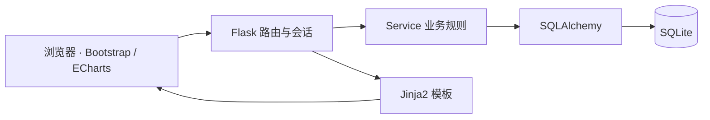

<div align="center">

# Campus Room Reservation

### 校园自习室与会议室预约系统

从查询空闲时段到预约、取消与统计，让共享空间的使用有据可查。


[功能概览](#功能概览) · [快速启动](#快速启动) · [业务规则](#业务规则) · [开发记录](#开发记录)

</div>

## 项目介绍

这是我独立完成的校园共享空间预约实践项目，采用 Flask、SQLAlchemy 和 SQLite 构建业务服务，以 Jinja2、Bootstrap 和 ECharts 实现页面与统计展示。

项目围绕一条完整业务流程展开：**查询房间 → 查看时段 → 创建预约 → 冲突校验 → 取消与释放 → 历史查询与统计**。开发过程中使用 AI 编程工具辅助需求分析、代码生成与调试，并记录人工核对业务规则和验证结果的过程。

## 功能概览

| 使用者 | 主要功能 |
| --- | --- |
| 学生 | 浏览房间与设备、查看时段、创建及取消预约、查询个人历史记录 |
| 管理员 | 维护房间信息、查询全部预约、查看统计看板 |
| 业务服务 | 时间重叠检测、人数与营业时间校验、取消权限校验、过期状态更新 |
| 统计看板 | 预约次数、预约状态分布、按开始小时统计的时段热度、使用率展示 |

## 技术结构



```text
app/
├── routes/          # 登录、房间、预约、管理与统计接口
├── services/        # 冲突检测、预约状态与统计逻辑
├── templates/       # Jinja2 页面
├── static/          # 样式与图表交互
├── models.py        # 用户、房间、预约数据模型
└── forms.py         # 输入解析与校验
tests/               # 核心业务规则测试
docs/                # 设计文档与 AI 辅助开发记录
```

## 快速启动

需要 Python 3.9 或更新版本。建议使用独立虚拟环境。

```bash
git clone https://github.com/ssf13546/campus-room-reservation.git
cd campus-room-reservation
python -m venv .venv
```

激活环境：

```powershell
# Windows PowerShell
.\.venv\Scripts\Activate.ps1
```

```bash
# macOS / Linux
source .venv/bin/activate
```

安装依赖、创建演示数据并启动：

```bash
pip install -r requirements.txt
python init_db.py
python run.py
```

打开 [http://127.0.0.1:5000](http://127.0.0.1:5000)。数据库在本地 `instance/` 中生成，不包含在仓库内。

| 演示角色 | 用户名 | 演示密码 |
| --- | --- | --- |
| 管理员 | `admin` | `admin123` |
| 学生 | `student` | `student123` |

以上账号用于本地演示。`run.py` 默认以开发模式启动；实际部署需更换默认账号和 `SECRET_KEY`、关闭 debug，并补充 CSRF 防护。

## 业务规则

**冲突检测。** 同一房间、同一天，已有有效预约满足 `已有开始 < 新结束` 且 `已有结束 > 新开始` 时，拒绝创建。相邻时段可以衔接，例如 14:00–15:00 和 15:00–16:00 不冲突。

**状态流转。** 预约可由 `booked` 变为 `cancelled` 或 `completed`。取消后不再占用时段；加载相关业务页面时刷新过期记录，已完成预约不可取消。

**输入与权限。** 默认营业时间为 08:00–22:00。系统校验过去日期、非法时间、房间容量和维护状态；学生只能取消自己的预约，管理员具有管理权限。

## 测试

```bash
python -m pytest -q
```

测试覆盖预约创建、不同用户冲突、相邻时段、非法时间、营业时间、容量限制、过去日期、取消释放、越权取消和过期状态更新。测试使用内存数据库，正常预约日期随运行日期生成。

## 当前范围

- 已实现预约管理与统计页面；`ai_service.py` 中的 AI 推荐为预留接口，尚未实现。
- 当前冲突检测面向课程演示；高并发预约场景仍需补充数据库层的并发控制。
- 使用率统计的日期窗口过滤仍待完善，当前展示口径不作为正式运营指标。

## 开发记录

- [开发设计文档](docs/开发设计文档.md)
- [AI 辅助开发过程](docs/AI辅助开发过程.md)
- [演示步骤与话术](docs/演示步骤与话术.md)

配套文档保留课程项目的设计过程，当前实现范围以本 README 与源码为准。

## 作者

[宋少峰 · ssf13546](https://github.com/ssf13546) · 南开大学软件工程 · 2028 届

